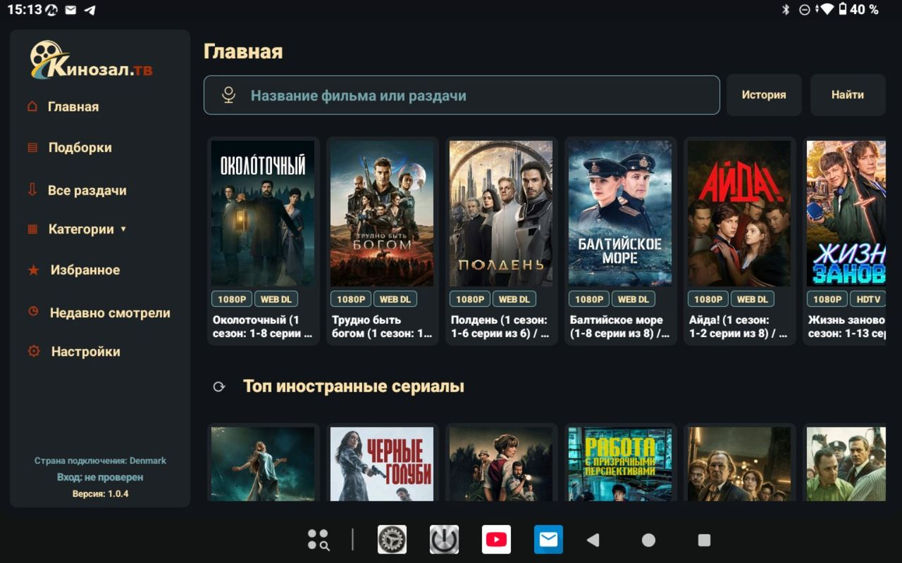
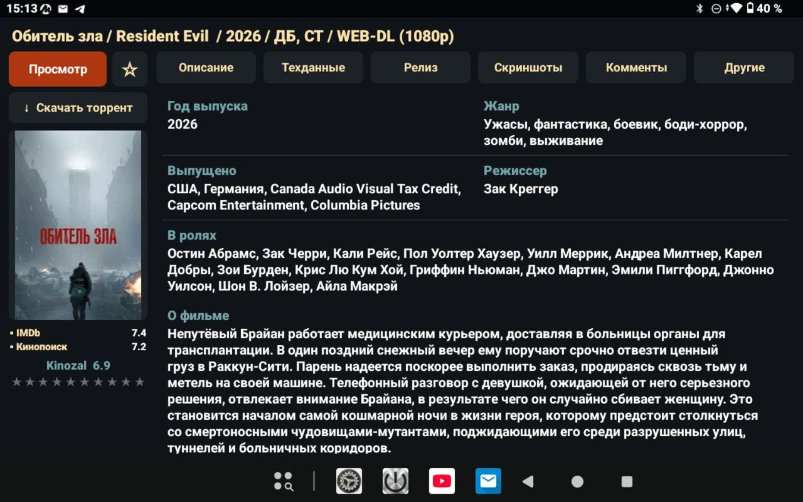
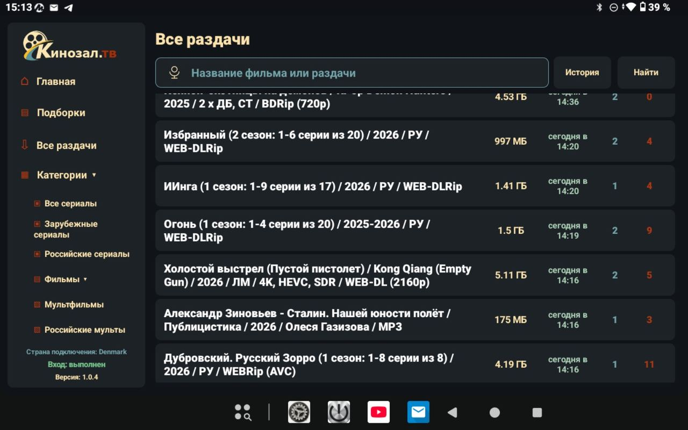
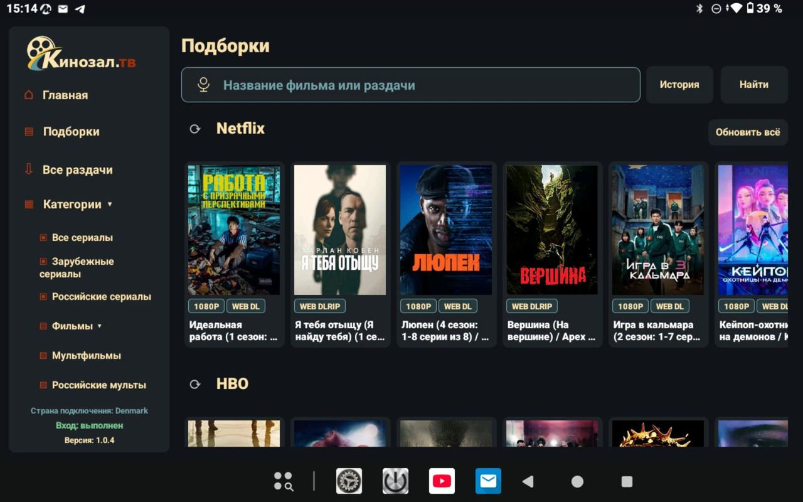
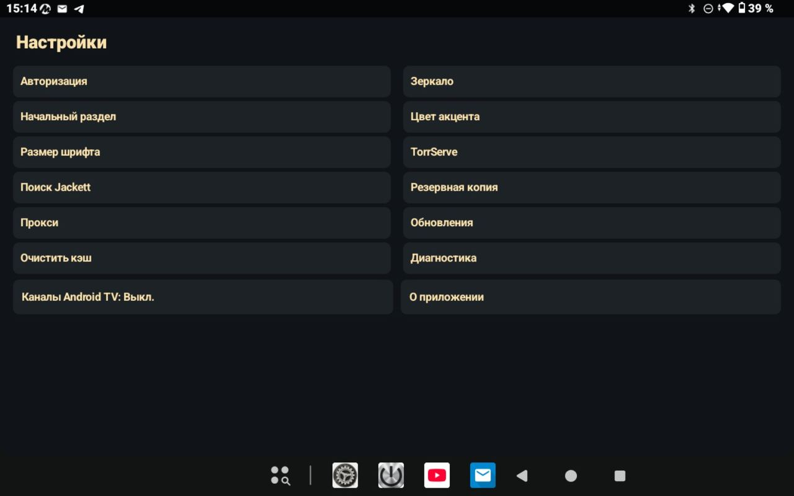

# Кинозал ТВ

**Каталог фильмов, сериалов и раздач для Android и Android TV**

[Скачать последнюю версию](https://github.com/Goblin-Mini/KinozalClient/releases/latest) · [Сообщить о проблеме](https://github.com/Goblin-Mini/KinozalClient/issues) · [Исходный код](https://github.com/Goblin-Mini/KinozalClient)

---

## О приложении

**Кинозал ТВ** — Android-клиент каталога Кинозал, ориентированный на большие экраны и управление телевизионным пультом. Приложение также подходит для смартфонов и планшетов Android.

Интерфейс помогает просматривать каталог, открывать карточки релизов, находить нужные публикации и передавать торрент в TorrServe MatriX.

## Скриншоты

| Главная | Карточка релиза |
|:--:|:--:|
|  |  |

| Все раздачи | Подборки |
|:--:|:--:|
|  |  |

| Настройки |
|:--:|
|  |

## Возможности

- **Главная лента** — подборки релизов и тематические блоки.
- **Каталог раздач** — просмотр общего списка публикаций.
- **Категории** — переход к сериалам, фильмам, мультфильмам и другим разделам каталога.
- **Поиск** — поиск по названию фильма или раздачи.
- **Карточка релиза** — описание, технические данные, сведения о релизе и скриншоты.
- **Избранное** — локальное сохранение выбранных раздач.
- **История просмотров** — быстрый возврат к недавно открытым материалам.
- **TorrServe MatriX** — передача торрента для воспроизведения через настроенный TorrServe.
- **Зеркала сайта** — возможность выбрать доступное зеркало каталога.
- **Прокси SOCKS5** — настройки прокси-подключения внутри приложения.
- **Резервная копия** — экспорт и восстановление пользовательских настроек.
- **Обновления** — проверка новой версии и установка обновления из приложения.
- **Каналы Android TV** — интеграция с каналами Android TV.
- **Диагностика** — инструменты для сбора диагностической информации.

## Совместимость

- Android и Android TV.
- ТВ-приставки на базе Android.
- Управление с помощью пульта Android TV.
- Для воспроизведения торрентов требуется отдельно настроенный TorrServe MatriX.

Совместимость зависит от версии Android, архитектуры устройства и установленных системных компонентов.

## Установка

1. Откройте страницу [последних релизов](https://github.com/Goblin-Mini/KinozalClient/releases/latest).
2. Скачайте APK из последнего релиза.
3. Установите APK на Android-устройство или ТВ-приставку.
4. При необходимости разрешите установку приложений из выбранного источника.
5. Откройте **Кинозал ТВ**, выберите зеркало и выполните авторизацию.

> Для установки обновления поверх существующей версии не удаляйте приложение: Android должен сохранить данные и настройки. Подпись APK должна совпадать с установленной версией.

## Обновления

Приложение поддерживает проверку доступных обновлений. Проверить новую версию можно вручную в разделе **Настройки → Обновления**. Также доступна настройка проверки при запуске.

Актуальные APK и описание изменений публикуются на странице [Releases](https://github.com/Goblin-Mini/KinozalClient/releases).

## Обратная связь

Нашли ошибку или хотите предложить улучшение?

- [Создать сообщение об ошибке](https://github.com/Goblin-Mini/KinozalClient/issues)
- [Посмотреть исходный код](https://github.com/Goblin-Mini/KinozalClient)

---

**Кинозал ТВ** · Android / Android TV

